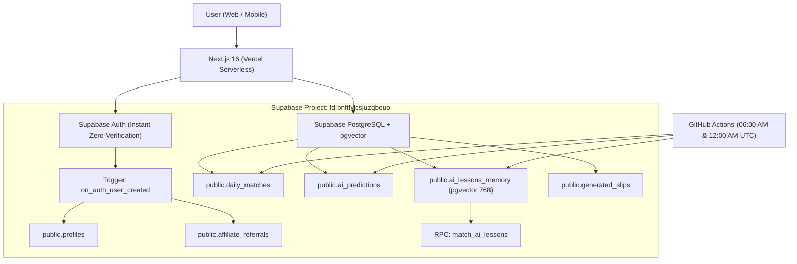

# 🚀 Oddora AI - Supabase Production Setup & Launch Guide

This document contains everything needed to launch, configure, and maintain Oddora AI on **Supabase**.

---

## 📌 Architecture Overview

Oddora AI operates on a hybrid serverless architecture backed by Supabase:



---

## 🔑 1. Live Supabase Project Credentials

Your project is already provisioned and active:

- **Project URL**: `https://fdlbnftfylcsjuzqbeuo.supabase.co`
- **Dashboard**: [https://supabase.com/dashboard/project/fdlbnftfylcsjuzqbeuo](https://supabase.com/dashboard/project/fdlbnftfylcsjuzqbeuo)

### Environment Variable Mapping

| Variable Name | Value | Used In |
|---|---|---|
| `NEXT_PUBLIC_SUPABASE_URL` | `https://fdlbnftfylcsjuzqbeuo.supabase.co` | Frontend (`.env.local`), Vercel |
| `NEXT_PUBLIC_SUPABASE_ANON_KEY` | `eyJhbGciOiJIUzI1NiIsInR5cCI6...` | Frontend (`.env.local`), Vercel |
| `SUPABASE_SERVICE_ROLE_KEY` | `eyJhbGciOiJIUzI1NiIsInR5cCI6...` | Backend (`.env`), Next.js Serverless API routes |
| `SUPABASE_URL` | `https://fdlbnftfylcsjuzqbeuo.supabase.co` | Backend (`.env`), GitHub Secrets |
| `SUPABASE_SERVICE_KEY` | `eyJhbGciOiJIUzI1NiIsInR5cCI6...` | Backend (`.env`), GitHub Secrets |

---

## 🗄️ 2. Applying Database Schema & Vector Search

The production-ready schema is located in [`supabase/schema.sql`](file:///Users/mac/Desktop/Oddora%20AI/supabase/schema.sql).

### How to Apply:
1. Log into your [Supabase Dashboard](https://supabase.com/dashboard/project/fdlbnftfylcsjuzqbeuo).
2. Go to the **SQL Editor** tab on the left sidebar.
3. Click **New Query**.
4. Copy and paste the entire contents of `supabase/schema.sql`.
5. Click **Run** (Ctrl/Cmd + Enter).

### What `supabase/schema.sql` configures:
- **Extensions**:
  - `vector`: pgvector extension for 768-dimensional AI semantic search.
  - `uuid-ossp`: UUID primary keys.
  - `pg_trgm`: Fast trigram text indexing.
- **Tables**:
  - `profiles`: User tiers (`FREE`, `PRO`, `VIP`), affiliate codes (`ODD-XXXXX`), affiliate earnings, and balance.
  - `affiliate_referrals`: 30% commission accounting and referral logs.
  - `daily_matches`: Fixture metadata, odds, statistics, and game status.
  - `ai_predictions`: AI selections, confidence scores (%), risk ratings, and outcomes.
  - `ai_lessons_memory`: 768-dim embeddings storing midnight autopsy lessons learned.
  - `generated_slips`: Saved booking codes and slips (SportyBet & Bet9ja).
- **Functions & Triggers**:
  - `on_auth_user_created`: Automatically creates a `public.profiles` row upon `auth.users` sign-up and credits the affiliate referrer.
  - `match_ai_lessons`: pgvector cosine similarity function used by Copilot and the self-learning autopsy engine.
- **Row Level Security (RLS)**:
  - Public read access for fixtures, predictions, and lessons.
  - Private user-isolated write access for accounts and affiliate earnings.
  - Service role full bypass for serverless background workers.
- **Realtime**:
  - `daily_matches`, `ai_predictions`, and `profiles` published to `supabase_realtime` for live match updates.

---

## 🔐 3. Supabase Auth Configuration (Zero-Verification Flow)

Oddora AI uses an **instant sign-up flow** so users can immediately access predictions and betslip generators without waiting for email verification:

1. Open your **Supabase Dashboard** > **Authentication** > **Providers** > **Email**.
2. **Turn OFF** "Confirm email" (toggle to disabled).
3. Under **Authentication** > **URL Configuration**:
   - **Site URL**:
     - Local development: `http://localhost:3000`
     - Production: `https://your-domain.vercel.app`
   - **Redirect URLs**:
     - `http://localhost:3000/**`
     - `https://your-domain.vercel.app/**`
4. Click **Save**.

---

## ⚡ 4. Live Verification

You can verify your Supabase database anytime by running:

```bash
cd frontend && node scripts/verify_supabase.mjs
```

### Expected Output:
```text
🚀 Connecting to Supabase at: https://fdlbnftfylcsjuzqbeuo.supabase.co

--- 1. Testing daily_matches Table ---
✅ daily_matches OK: Found 3 sample fixtures.
--- 2. Testing ai_predictions Table ---
✅ ai_predictions OK: Found 3 sample predictions.
--- 3. Testing ai_lessons_memory Table ---
✅ ai_lessons_memory OK: Found 2 lessons in vector database.
--- 4. Testing match_ai_lessons RPC (pgvector) ---
✅ pgvector match_ai_lessons RPC OK: Returned nearest neighbors.
--- 5. Testing profiles Table ---
✅ profiles OK: Found member profiles.
--- 6. Testing affiliate_referrals Table ---
✅ affiliate_referrals OK: Found logged referrals.
--- 7. Testing generated_slips Table ---
✅ generated_slips OK: Found saved slips.
========================================
🟢 100% SUPABASE PRODUCTION READINESS CONFIRMED!
```

---

## 🌐 5. Deploying Both Frontend & Backend on Vercel + Supabase ($0 Cloud Setup)

Oddora AI is **100% serverless**. You do **NOT** need to pay for Render, AWS EC2, or keep a Python server running. The Next.js 16 App Router (`src/app/api/...`) provides all backend API endpoints directly on Vercel, backed by Supabase and Groq Cloud!

### Exact Vercel Deployment Steps:

1. Push your repository to **GitHub**.
2. Sign in to [Vercel](https://vercel.com) and click **Add New > Project**.
3. Select your repository and configure:
   - **Framework Preset**: `Next.js`
   - **Root Directory**: Select `frontend` (or `./` if deploying from the frontend root).
   - **Build Command**: `npm run build`
   - **Output Directory**: `.next`
4. In **Settings > Environment Variables**, paste these exact keys:

| Environment Variable | Value | Description |
|---|---|---|
| `NEXT_PUBLIC_SUPABASE_URL` | `https://your-project.supabase.co` | Supabase Cloud Database URL |
| `NEXT_PUBLIC_SUPABASE_ANON_KEY` | `your_supabase_anon_key_here` | Supabase Anon Key |
| `SUPABASE_SERVICE_ROLE_KEY` | `your_supabase_service_role_key_here` | Privileged DB Access (Admin/Trigger) |
| `GROQ_API_KEY` | `your_groq_api_key_here` | Groq LLaMA 3.3 70B inference |
| `API_FOOTBALL_KEY` | `your_api_football_key_here` | Live Football API Feed |
| `GEMINI_API_KEY` | `your_gemini_api_key_here` | 768-dim Embeddings |
| `NEXT_PUBLIC_API_URL` | *(leave empty)* | Routes all requests to same-origin `/api/...` |

5. Click **Deploy**. Vercel will build and deploy your entire platform globally.

### ⏱️ Automated $0 Cron Scheduling on Vercel:
Oddora includes [`vercel.json`](file:///Users/mac/Desktop/Oddora%20AI/vercel.json) at repo root:
- **06:00 AM UTC**: Calls `/api/admin/trigger-morning` (daily match ingest & AI predictions).
- **12:00 AM UTC**: Calls `/api/admin/trigger-midnight` (grading, win rate calculation & autopsy extraction).

